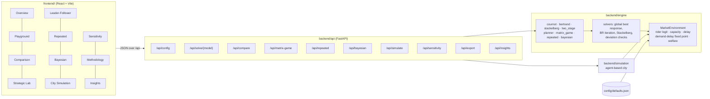
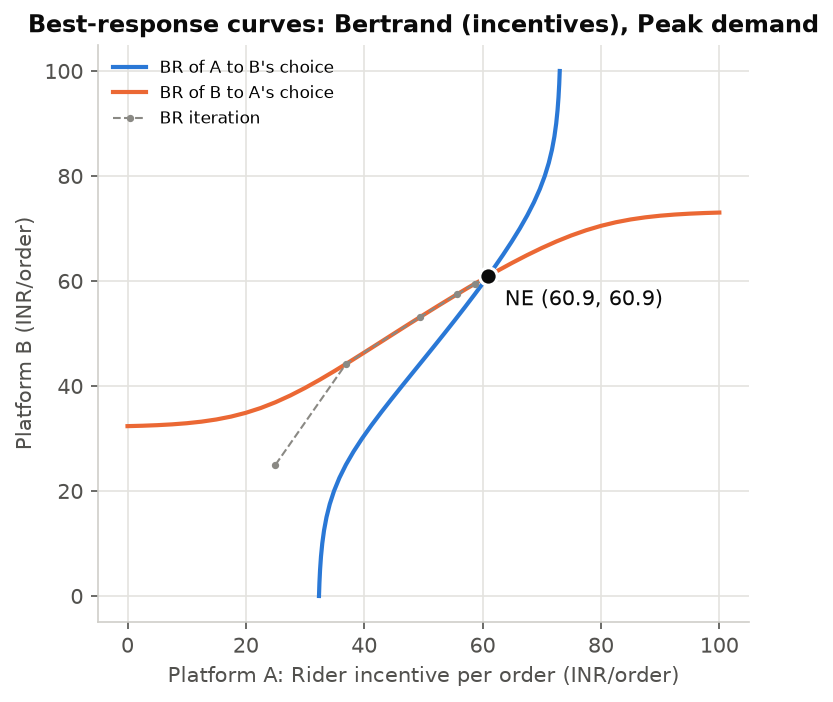
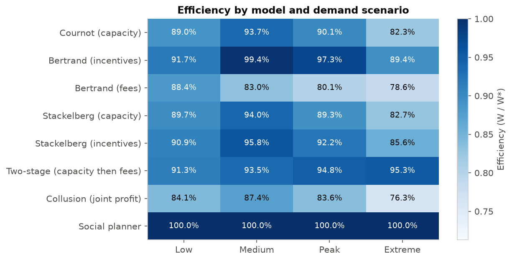
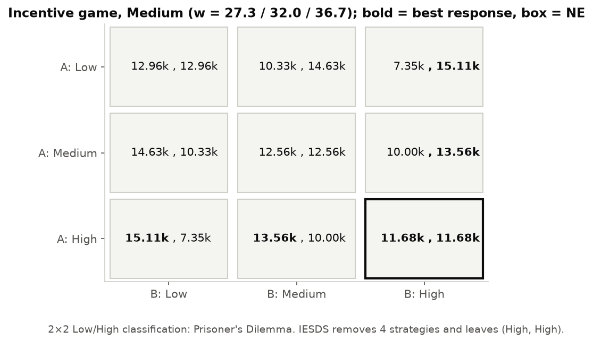
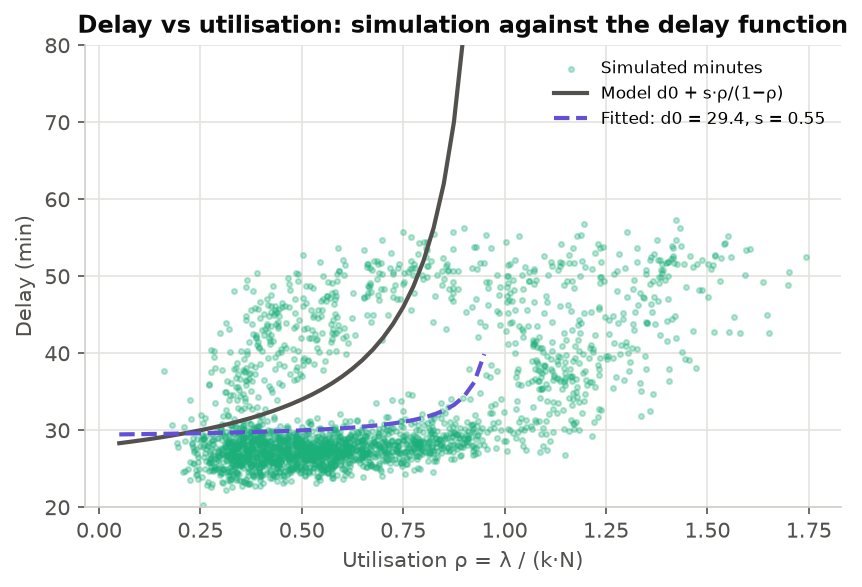

# Riders, Rivals and Rush Hours

**A game-theoretic analysis of incentive and capacity competition between food delivery platforms.**

During lunch and dinner peaks, two delivery platforms (A and B, motivated by Swiggy and Zomato) serve the same customers
and draw on an overlapping pool of multi-homing riders. When one platform raises rider incentives, riders shift away
from the rival, so each platform's delays, orders and costs depend on the other's choices. This project models those
decisions as strategic games, solves them numerically on **one shared market environment**, verifies every
equilibrium, validates the delay model with an agent-based city simulation, and presents everything in an
interactive web app.

| Layer | Stack |
|---|---|
| Game-theory engine | Python 3.11, NumPy, SciPy (`backend/engine/`) |
| Agent-based simulation | Python, NumPy (`backend/simulation/`) |
| API | FastAPI + Pydantic, in-memory cache (`backend/api/`) |
| Frontend | React 18 + Vite + TypeScript + Tailwind, Recharts, KaTeX, Framer Motion (`frontend/`) |
| Tests | pytest (54 tests: textbook sanity cases, fixed-point convergence, deviation checks for every model and scenario, API, simulation) |

---

## Quick start (Windows PowerShell)

Prerequisites: **Python 3.11** and **Node.js LTS** (`winget install OpenJS.NodeJS.LTS`). Run each command on its own line.

**1. Backend** (first run creates `backend\.venv` and installs requirements):

```powershell
.\start-backend.ps1
```

The API runs on http://127.0.0.1:8000 (interactive docs at http://127.0.0.1:8000/docs). On start-up it pre-computes the
default configuration in the background (about 1–2 minutes), so the first page loads are instant afterwards.

**2. Frontend** (in a second PowerShell window; first run installs npm packages):

```powershell
.\start-frontend.ps1
```

Open http://localhost:5173. The Vite dev server proxies `/api` to the backend.

**3. Tests** (backend pytest, plus the frontend type-check and build if `node_modules` exists):

```powershell
.\run-tests.ps1
```

**4. Report assets** (regenerates `reports/figures/*.png` and `docs/RESULTS.md`):

```powershell
.\make-report.ps1
```

If PowerShell blocks scripts, allow them for the current window only:

```powershell
Set-ExecutionPolicy -Scope Process -ExecutionPolicy Bypass
```

---

## Architecture



```
Riders_Rivals_Rushhours/
├── backend/
│   ├── config/defaults.json      every parameter, one file
│   ├── engine/                   market.py (shared environment), solvers.py, one module per game, registry, insights
│   ├── simulation/               abm.py (agent-based model), runner.py (Monte Carlo + validation)
│   ├── api/main.py               FastAPI endpoints
│   └── tests/                    pytest suite
├── frontend/src/                 pages/ (11 pages), components/, lib/
├── docs/                         ASSUMPTIONS.md, MODEL.md, RESULTS.md, SELF_REVIEW.md
├── reports/                      make_figures.py, generate_results.py, figures/*.png
├── start-backend.ps1  start-frontend.ps1  run-tests.ps1  make-report.ps1
```

**Design rule:** all model math lives in the backend engine. The frontend only calls the API and visualises results.
Every game model calls the same `MarketEnvironment`, so only the strategic variable and the timing differ between models.

## Models

| # | Model | Strategic variable | Syllabus module |
|---|---|---|---|
| 1 | Cournot | rider capacity N_i (incentive from inverse supply) | 1 |
| 2 | Bertrand on incentives (+ homogeneous / Bertrand-paradox toggle) | incentive w_i | 1 |
| 3 | Bertrand on fees | fee p_i (capacity fixed) | 1 |
| 4 | Stackelberg (capacity and incentive leadership) | leader commits first | 4 |
| 5 | Two-stage: capacity, then fees (SPE) | N_i, then p_i | 4 |
| 6 | Social planner and collusion benchmarks | all instruments / joint profit | 1, 7 |
| 7 | Strategic form: pure NE, IESDS/IEWDS, mixed NE, maxmin, PD detection | Low / Medium / High incentive | 2, 3, 6 |
| 8 | Repeated game: δ*, tournament, noisy monitoring | cooperate / defect each day | 7 |
| 9 | Bayesian Cournot | type-contingent capacity | 5 |

Every equilibrium is verified: no player has a profitable unilateral deviation on a 401-point grid (plus local
polishing). The check is returned in every API response and shown as a badge in the UI.

## API

| Method | Endpoint | Purpose |
|---|---|---|
| GET | `/api/config` | Defaults, slider metadata, models, scenarios |
| POST | `/api/solve/{model}` | One model × scenario, with BR curves and verification |
| POST | `/api/compare` | All models × all scenarios, efficiency heatmap |
| POST | `/api/matrix-game` and `/api/matrix-game/custom` | Market payoff matrix / any bimatrix game |
| POST | `/api/repeated` | δ*, value curves, tournament, noise sweep |
| POST | `/api/bayesian` | Bayesian Cournot |
| POST | `/api/simulate` and `/api/simulate/validate` | Agent-based run with frames + Monte Carlo; cross-scenario validation |
| POST | `/api/sensitivity` | One-parameter sweep (β, c, k, R, Λ, w0, b, s) |
| POST | `/api/insights` | Auto-generated findings |
| GET/POST | `/api/export` | CSV of comparison / sensitivity / simulation / tournament |

Every POST accepts `{"params": {"market": {"beta": 0.2, ...}}}` to override any default.

## Headline results (default parameters)

See [docs/RESULTS.md](docs/RESULTS.md) for full tables. In brief:

- **Incentive wars mostly transfer surplus to riders.** Going from the incentive cartel to one-shot incentive competition at
  Extreme demand raises incentive spend by ₹28k/h but cuts delay by only 2.8 min; ~84% of the extra spend becomes rider surplus.
- **Capacity leadership pays; incentive leadership pays the follower more.** Capacities are strategic substitutes, while incentives
  are complements, which produces a second-mover advantage.
- **Cooperation is hardest at peaks.** The grim-trigger δ* rises from 0.51 (Low) to 0.71 (Extreme); 5% observation noise
  collapses grim-trigger cooperation, while Generous TFT keeps ~80%.
- **Kreps–Scheinkman holds.** Capacity-then-fee SPE capacities are within 0.7% of Cournot capacities.
- **The analytical delay function is validated within ~17% MAPE.** It is close at peak and conservative at moderate load.

## Screenshots

UI screenshots are not committed. To capture them, open each page, use your OS screenshot tool, and save them as
`docs/screenshots/<page>.png`. Every chart also has its own **PNG** download button (top-right of each card), and tables
have **CSV** buttons. The report-quality figures below are generated by `reports/make_figures.py`:

| | |
|---|---|
|  |  |
|  |  |

## Documentation

- [docs/ASSUMPTIONS.md](docs/ASSUMPTIONS.md): every assumption and default, with justification (including the one
  calibration change to the brief, a = 4.0, and exactly why).
- [docs/MODEL.md](docs/MODEL.md): full mathematical formulation and how each equilibrium is computed and verified.
- [docs/RESULTS.md](docs/RESULTS.md): generated summary of the default run.
- [docs/SELF_REVIEW.md](docs/SELF_REVIEW.md): which comparisons are like-for-like and which rely on different instruments.
